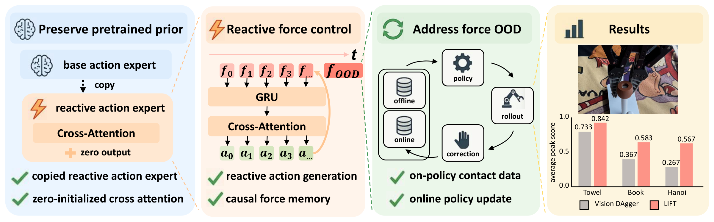

<h2 align="center">LIFT</h2>
<h3 align="center">Never Too Late for Force:<br>Accelerating VLA Post-Training with Reactive Force Injection</h3>

<p align="center">
  🎉 <strong>CoRL 2026 Spotlight (Top 10%)</strong>
</p>

<p align="center">
  <a href="https://y-wng.github.io/">Yi Wang</a><sup>12*</sup>,
  <a href="https://wendichen.me">Wendi Chen</a><sup>12*‡</sup>,
  <a href="https://github.com/nssmd">Zimo Wen</a><sup>14*</sup>,
  <a href="https://hanxue.me">Han Xue</a><sup>1</sup>,
  Xueqi Li<sup>23</sup>,
  <a href="https://virlus.github.io/">Wenye Yu</a><sup>12</sup>,
  <br>
  Zhijie Chen<sup>1</sup>,
  Hao Yang<sup>1</sup>,
  <a href="https://lyuj1998.github.io">Jun Lv</a><sup>15</sup>,
  <a href="https://alvinwen428.github.io">Chuan Wen</a><sup>1†</sup>,
  <a href="https://www.mvig.org">Cewu Lu</a><sup>125†</sup>
  <br>
  <sup>1</sup>Shanghai Jiao Tong University &nbsp;
  <sup>2</sup>Shanghai Innovation Institute
  <br>
  <sup>3</sup>Southern University of Science and Technology &nbsp;
  <sup>4</sup>Zhiyuan College, Shanghai Jiao Tong University
  <br>
  <sup>5</sup>Noematrix Ltd.
  <br>
  <sup>*</sup>Equal contribution &nbsp;
  <sup>‡</sup>Project lead &nbsp;
  <sup>†</sup>Corresponding authors
</p>

<p align="center">
  <a href="https://arxiv.org/abs/2607.14236">📄 Paper</a> &nbsp;·&nbsp;
  <a href="https://lift-policy.github.io/">🌐 Project Page</a>
</p>

**LIFT (Late Reactive Injection of Force for VLA Post-Training)** adds contact
reactivity to pretrained π₀.₅ policies. A copied reactive action expert and
zero-initialized cross-attention inject causal force memory, while online DAgger
combines offline demonstrations with human corrections.

<p align="center">
  
</p>

Built on OpenPI, this repository provides **policy training and model inference**,
not a robot-control or data-collection stack.

## ⚙️ Installation

Use Linux, Python 3.11.8 or newer within the 3.11 series, CUDA-capable NVIDIA GPUs, and `uv`.

```bash
git clone https://github.com/y-wng/LIFT.git
cd LIFT
GIT_LFS_SKIP_SMUDGE=1 uv sync --locked
```

Dependencies are specified in `pyproject.toml` and pinned in `uv.lock`.

On an unstable connection (for example a proxy that drops long downloads), use
the resumable wrapper instead. It prefetches the locked wheels with `curl -C -`,
verifies their sha256, and rerunning it continues interrupted downloads:

```bash
uv run --no-project --python 3.11 --with packaging \
  scripts/uv_resumable_sync.py -- --python 3.11
```

## 📚 Offline Training

1. **Prepare data.** Use LeRobot datasets with wrist images (`left_wrist_img`),
   7D `state` and `actions`, and task descriptions. The supplied task presets use
   10 Hz data. Set the dataset and checkpoint roots:

   ```bash
   export HF_LEROBOT_HOME=/path/to/lerobot
   export OPENPI_CHECKPOINT_ROOT=/path/to/checkpoints
   ```

2. **Configure the task.** Set the dataset `repo_id`, initialization
   `weight_loader`, and normalization `assets` in
   [src/openpi/training/config.py](src/openpi/training/config.py).
   The Book preset uses `flexiv/book_insertion_v3_100`, initializes from
   `$OPENPI_CHECKPOINT_ROOT/30000/params`, and reads statistics from
   `$OPENPI_CHECKPOINT_ROOT/30000/assets/flexiv/book_insertion_v3_100/norm_stats.json`.
   To compute statistics for new data, see [scripts/compute_norm_stats.py](scripts/compute_norm_stats.py).

3. **Train the offline π₀.₅ policy.** The Book preset uses two GPUs:

   ```bash
   CUDA_VISIBLE_DEVICES=0,1 uv run python scripts/train.py \
     pi05_iPhoneSingle_book_insertion_v3_100 \
     --exp-name offline \
     --checkpoint-base-dir "$OPENPI_CHECKPOINT_ROOT" \
     --no-wandb-enabled
   ```

   Checkpoints are saved under `<checkpoint-root>/<config>/<exp-name>/<step>/`.
   Task presets and data transforms are in `src/openpi/training/config.py`;
   training overrides and resume instructions are documented in [scripts/train.py](scripts/train.py).

### AR3 force + visuo-tactile (muscleVLTA, LeRobot v3.0)

The AR3 recordings (15 fps, 7 joints + gripper, 9D actions with gripper force level, 7 joint torques, two finger
6D wrenches and tactile depth sidecars) are read natively as LeRobot v3.0 (no conversion needed). The reactive expert
cross-attends to a multi-rate mixture-of-transformers memory: a fast force expert over the 20D force sequence
(7 torques + 2×6D finger wrenches + gripper force level, one token per frame) and a slow tactile expert
(one token per `tactile_stride` frames). Main config: `pi05_ar3_force_visuotactile_reactive`
(ablations `pi05_ar3_force_reactive`, `pi05_ar3_base`; CPU smoke test `pi05_ar3_force_visuotactile_reactive_debug`).

```bash
# Computes norm stats on first run, then trains on GPUs 6,7 (FSDP over 2 devices).
bash scripts/train_ar3_force_visuotactile_gpu67.sh
```

On shared GPUs with only a few GB free, use the low-memory launcher instead (config
`pi05_ar3_force_visuotactile_reactive_lowmem`: LoRA experts, frozen SigLIP, batch 4; waits for free memory, caps JAX at
free memory minus 2 GB and auto-resumes after OOM):

```bash
bash scripts/train_ar3_force_visuotactile_gpu67_lowmem.sh
```

See the script headers for overrides (dataset, weights, GPUs, batch size, resume). At inference, send
`observation/force_level` (the commanded gripper force level) in addition to the force and tactile readings.

#### AR3 inference

##### Laptop preparation and read-only VS Code debug

The laptop uses its own project `.venv` (Python 3.11), independently of the H100 training environment:
`GIT_LFS_SKIP_SMUDGE=1 uv sync --locked --python 3.11`. Keep the entire checkpoint step directory,
including `params/` and `assets/`, at `infer_checkpoint/29999`. The PaliGemma tokenizer belongs at
`${OPENPI_DATA_HOME:-$HOME/.cache/openpi}/big_vision/paligemma_tokenizer.model`.
Use the **lowmem** model configuration for these LoRA weights; no adapter merge or second training stage is
required to run inference. Completing the offline step budget does not establish physical task success;
LIFT's online corrective DAgger is an additional adaptation procedure. A still-zero force cross-attention
output blocks force/tactile influence even when the reactive model runs; inference setup cannot repair a
force pathway frozen during training.

```bash
./infer_oneclick.sh --dry-run  # commands only; no device access
./infer_oneclick.sh --check    # local prerequisites only
./infer_oneclick.sh            # start hardware preparation tabs; NOT policy action execution
```

The launcher reuses the sibling `ar3_ws`, `V3_Gripper`, and `lerobot_89236e_muscleTWAM` projects.
It starts arm bringup without the MoveJ demo, the two remote SSH services, the tactile bridge, independent
front/wrist Orbbec ROS cameras, and the camera tilt node at **40 degrees**. It does **not** start
MessageBridge/Puppetry, retargeting, gripper teleoperation, recording, or a robot action-execution client.
**Arm bringup powers the arm, and the camera servo moves.** Clear the workspace before running it;
closing a terminal is not an emergency stop or a guarantee of arm power-off.
SSH uses verified `known_hosts` entries and interactive/key authentication, never embedded passwords.
The readiness tab requires actual sensor messages, measured tilt feedback, and valid, connected, initialized
gripper feedback, not only advertised topics or a responsive gRPC service. The front camera uses MJPG;
the Gemini 305 wrist camera uses its supported **YUYV** profile at 640x480/30 FPS with the **V4L2** UVC
backend. On this setup, libuvc can report the wrist camera online but produce no frames even with YUYV.

After the `ready` tab reports preparation complete, select **`infer_muscleVLTA_debug`** in VS Code's
Run and Debug menu and press **F5**. This configuration loads the model **inside the debugged process on GPU 0**,
reads real observations, and opens Rerun with cameras, tactile depth, wrenches, joint states and predicted actions.
Before loading the model, it checks a complete real observation and fails early if an input is unavailable.
No predicted action is sent to the arm or gripper. Outputs go to `outputs/infer_muscleVLTA_debug/`.
Stop with Ctrl+C in the integrated terminal to save the summary and close the observation worker cleanly.

To check inputs without loading the checkpoint, allocating GPU memory, or opening Rerun:

```bash
.venv/bin/python scripts/infer_musclevlta_debug.py --check-observations
```

This check is strictly read-only. A camera node/topic with no image samples is not ready; inspect the camera
task's log and supported stream format. `GetAllState` reporting `connected=False`, `valid=False`, or
`init_state != 1` requires motor preparation through your approved driver, not a larger inference timeout.

Breakpoints in `scripts/ar3_force_visuotactile_client_example.py` and `src/openpi/policies/policy.py` run in
that same process. JAX-compiled model functions normally hit Python breakpoints only during tracing; for
line-by-line model debugging, temporarily add `"JAX_DISABLE_JIT": "1"` to the launch configuration's `env`
(much slower). The ROS worker is deliberately a separate Python 3.12 process, not a second model process.

Real observations come from `/front/color/image_raw`, `/wrist/color/image_raw`, `/joint_states`,
and `/v3_gripper/tactile/{sensor_0,sensor_2}/{depth,wrench}`. Gripper position is obtained by read-only
`GetAllState`; neither the launcher nor debug performs CAN `Connect`, motor initialization, or motion.
If the gripper has no valid connected state, prepare it using the approved device workflow first;
debug must not substitute a fabricated position. `--force-level 80` is the **known commanded SDK setting**,
not a measured force; keep it consistent with the actual gripper setting. Missing, invalid or stale observations
are errors, not zero-filled inputs. Finger wrenches remain in the same sensor-local frames used in training.

Do not run the collection program alongside these ROS cameras: each camera must have only one owner.
The launcher defaults to ROS domain **111** and the camera serials from the capture configuration.
Use `./infer_oneclick.sh --help` for path/device overrides and flags that preserve existing nodes;
when overriding topics/domain/device addresses, update `.vscode/launch.json` consistently.
`infer_onecilck.sh` remains a compatibility alias for the originally requested spelling.

For the separate WebSocket workflow below, use `./infer_oneclick.sh --with-policy` (or the standalone serving
launcher). **Do not also press F5 with a second model on the same GPU.** Normal preparation intentionally
does not start a policy server, leaving GPU memory available for local debugging.

##### Explicit LIVE execution (physical motion)

The original **`infer_muscleVLTA_debug`** remains prediction-only. The separate VS Code configuration
**`infer_muscleVLTA_LIVE (MOVES ARM + GRIPPER)`** uses `--source ros --execute` and will send real targets.
Stop the read-only model first to free its GPU memory. Only start LIVE with a clear workspace, a verified
starting pose and checkpoint/action units, no teleoperation/replay/MoveIt goal, and an accessible physical
emergency stop. Do not attach a debugger to the independent control worker.

The LIVE configuration runs up to **300 control steps** with repeated closed-loop replanning, then requests
a stop. This is 20 seconds at the nominal 15 Hz; inference and controller waits can make the run longer.
The step budget is not automatic task-completion detection. Joint target increments remain limited to
0.03 rad and joint command velocity to 0.1 rad/s; raw model targets farther than 0.25 rad from feedback
are rejected, and gripper SDK speed remains 10. The worker additionally reads actual URDF joint limits and
requires the active seven-joint position controller, fresh controller/sensor feedback, and exclusive discovered
command ownership. These limits are not collision checking or a guarantee of safe contact. Other private gRPC
clients cannot be discovered; ensure no other program commands the gripper.

As in replay/preview, the client clips finite gripper predictions to the SDK ranges: position **0..1000**
and force level **20..100**. This includes LIVE; small endpoint overshoots do not abort a run. Each adjustment
logs the control step and original/bounded values, while the rollout keeps raw predictions separate from
acknowledged targets. The worker still rejects invalid commands and rounds valid gripper commands to SDK
integers. Raw joint targets reach the worker unchanged so its joint-limit and deviation checks remain effective.

By default, LIVE first checks a complete observation through the read-only worker, before loading or warming
the model. If `--initialize-gripper` is explicitly supplied, this full check is deferred to the LIVE worker
after initialization; it is not bypassed. No policy action is allowed without valid real inputs.
The model warms up before the control worker starts. Every observation authorizes one action only;
expired observations, failed acknowledgements and malformed/nonfinite or invalid joint targets abort the session.
After the first command, a separate watchdog requests a stop if no next command arrives within 0.5 s,
including while the model/debugger is paused. Stop requests a short arm hold and gripper `Stop`, and checks
controller hold feedback and the gripper acknowledgement. It does **not** power off the arm or replace a
safety-rated emergency stop; RPC/ROS delays or failures can prevent a confirmed stop. A stopped session
cannot resume commands: restart explicitly after inspecting the cause.

The gripper CAN connection must already be prepared. LIVE does not disconnect that shared connection on
exit. Motor calibration additionally requires `--initialize-gripper` (not enabled in the launch config);
it can cause full-stroke motion. Changing the force or position predictions in LIVE controls the actual
gripper; unlike read-only mode, acknowledged force commands become the next observation's force setting.
Ctrl+C/EOF or the step budget ends the run with a stop request. Closing only Rerun does not stop control.

##### WebSocket serving and replay

Serve a trained checkpoint (defaults to the latest step of the newest `pi05_ar3_force_visuotactile_reactive_lowmem`
run, GPU 6, `127.0.0.1:8000`; the header of the script lists all overrides):

```bash
bash scripts/serve_ar3_force_visuotactile.sh
# Explicit step directory, another GPU (or OPENPI_SERVE_GPU=cpu), extra serve_policy.py arguments last:
OPENPI_SERVE_GPU=7 bash scripts/serve_ar3_force_visuotactile.sh \
  checkpoints/pi05_ar3_force_visuotactile_reactive_lowmem/<run>/<step> --record
```

The server is unauthenticated and only listens on localhost by default. Reach it from the robot PC through an SSH
tunnel (`ssh -N -L 8000:127.0.0.1:8000 <server>`), or set `OPENPI_HOST=0.0.0.0` on a trusted network only.

[scripts/ar3_force_visuotactile_client_example.py](scripts/ar3_force_visuotactile_client_example.py) is the
robot-side client. `--source` selects where observations come from: `dataset` replays a recorded episode, `fake`
sends random data, and `MODULE:CLASS` loads your robot driver. A driver is a class constructed without arguments,
with `observe() -> dict` (the keys below) and `execute(action)`, plus optional `done` and `close()`. The client
itself needs only `numpy` and `openpi-client`. Inputs are one frame per request, or `(t, ...)` sequences for the
force / tactile keys in reactive mode:

| Key | Shape | Content |
| --- | --- | --- |
| `observation/front_image`, `observation/wrist_image` | (H, W, 3) uint8 | RGB images |
| `observation/state` | (8,) | 7 joint positions [rad] + gripper position (0..1000) |
| `observation/arm_effort` | (7,) | measured joint torques [Nm] |
| `observation/finger_wrench_0`, `observation/finger_wrench_2` | (6,) | finger wrenches Fx Fy Fz Mx My Mz in the SDK units of the recording, each in its own (mirrored) sensor frame |
| `observation/tactile_depth` | (2, h, w) | tactile depth of both fingers. The client area-downsamples it to the server's `tactile_shape` and sends float16, the same values as the training cache. |
| `observation/force_level` | scalar | current gripper force level command (20..100) |
| `prompt` | str | task instruction. Optional: replay uses the episode task, and the launcher sets a default prompt. |

The policy returns `actions` of shape `(n, 9)`: 7 absolute joint position targets [rad], gripper position (0..1000) and
gripper force level (20..100) at 15 fps. Joint torques and finger wrenches are inputs only: the recordings contain no
torque commands, so the policy does not predict joint forces; contact forces result from tracking the joint / gripper
targets with the commanded force level.

```bash
python scripts/ar3_force_visuotactile_client_example.py --source my_ar3:AR3Robot               # reactive mode
python scripts/ar3_force_visuotactile_client_example.py --source my_ar3:AR3Robot --mode chunk --execute-steps 10
python scripts/ar3_force_visuotactile_client_example.py --source fake --max-steps 30            # connection test
```

- `chunk`: one full inference (VLM + both experts) per action chunk.
- `reactive` (default for reactive configs): the VLM runs once per chunk (`reactive_replan`), then the reactive expert
  is re-run every `k = cross_attention_latency + 1` steps with all force / tactile readings since the chunk start
  (`reactive_step`), so the remaining actions of the chunk react to contact. The server keeps the chunk state per
  connection; actions only depend on readings at least `cross_attention_latency` steps old, so streaming gives the same
  actions as re-running the whole chunk with the full readings.
- Before execution, the client clips each joint target to the measured joint position ± `--max-joint-step` (default
  0.1 rad). It also clips the gripper target to 0..1000 and the force level to 20..100. The robot driver is still
  responsible for joint, workspace and velocity limits.

Replaying a recorded episode is an offline check of a checkpoint. It uses the same path as the robot: the WebSocket
connection, the transforms and reactive streaming. The replay is open loop: each recorded frame is sent, and the
predicted actions are compared with the recorded ones. Run it on the GPU server in the openpi environment, which
already contains `rerun-sdk` 0.23.1:

```bash
uv run scripts/ar3_force_visuotactile_client_example.py --source dataset \
  --dataset /data/jiang/utilData/ar3_force_computeChargingPullOut_force_aware --episode 16 \
  --output-dir replay/episode_16 --rerun replay/episode_16.rrd
```

The summary reports the inference latency and the errors against the recorded actions:

- joint MAE in degrees, per joint and averaged, shown next to the hold-position baseline (keeping the current joints)
- gripper and force level MAE
- joint MAE for each step of the chunk

`--output-dir` writes `rollout.npz` (state and policy / executed / recorded actions for each step) and
`summary.json`.

The `.rrd` file uses the panels of the dataset viewer: cameras, gripper, force level, state / action, arm effort,
finger wrenches and tactile depth. It adds the policy actions, a "policy vs recorded" tab for each joint and the
inference latency. Open it with the same rerun version that wrote it (`uvx --from rerun-sdk==0.23.1 rerun
replay/episode_16.rrd`). You can also stream to a running viewer with `--rerun rerun+http://HOST:9876/proxy`, or open
one with `--rerun spawn`.

On the robot PC, install the client with `pip install --no-deps -e packages/openpi-client` plus `msgpack websockets
pillow dm-tree typing_extensions`. This avoids downgrading numpy in an existing numpy 2 environment, because
openpi-client pins `numpy<2`.

## 🔄 Online DAgger Launchers

The online loop consists of policy inference, human correction, data transfer,
format conversion, and policy updates. The steps below describe this general
workflow; the quoted notes specify our LIFT setup.

1. **Real-world inference.** Run the current policy and connect its predictions
   to the robot's observation and action-execution loop.

   > **LIFT setup:** We deploy on a Flexiv robot arm. Model inference is provided
   > by [scripts/serve_policy.py](scripts/serve_policy.py), with a WebSocket client
   > in [packages/openpi-client](packages/openpi-client/src/openpi_client/websocket_client_policy.py).
   > Robot drivers and action execution are external to this repository.

2. **Human-intervention data collection.** Record corrective actions together
   with images, robot state, force measurements, and intervention labels.

   > **LIFT setup:** We use TDK for human-intervention data collection and save
   > the recordings locally in **NEDF2** format. The TDK collection system is
   > not included in this repository.

3. **Data upload.** Transfer completed episodes from the local collection
   computer to the training server, preserving their directory structure.

   > **LIFT setup:** Local NEDF2 episodes are uploaded to a cloud server before
   > conversion. Upload tooling is deployment-specific and is not bundled here.
   > Publish each episode's `.done` marker only after all files have arrived;
   > the converter also accepts the legacy `.down` marker.

4. **Format conversion.** Convert uploaded recordings into datasets that the
   training loader can consume.

   > **LIFT setup:** On the cloud server,
   > [scripts/nedf2_to_lerobot_incremental_flexiv_tdk.sh](scripts/nedf2_to_lerobot_incremental_flexiv_tdk.sh)
   > watches completed NEDF2 episodes and exports per-episode **LeRobot** datasets.
   > This optional conversion path requires the external `nmx_nedf_api` reader SDK.
   > The following command selects the Book task; other presets are listed in the script.

   ```bash
   SOURCE_DIR=/path/to/uploaded_nedf2 \
   OUTPUT_PATH=/path/to/lerobot_corrections \
   CONFIG_PATH=preprocess_data/configs/book_insertion_v3_online.yaml \
   bash scripts/nedf2_to_lerobot_incremental_flexiv_tdk.sh
   ```

5. **Online post-training.** Mix the new corrections with offline demonstrations,
   train the policy, and use an updated checkpoint for subsequent rollouts.

   > **LIFT setup:** The trainer scans completed LeRobot exports and uses a fixed
   > **1:1 offline:online** mixture. Online LIFT data requires 6D `left_wrench`
   > and `control_flag`; intervention chunks use `control_flag == -1` by default.
   > Set `OPENPI_INTERVENTION_VALUE` if your recordings use a different label.
   > Run training in a separate terminal from the converter, with
   > `OPENPI_LOCAL_LEROBOT_DATA_ROOT` pointing to the converter's `OUTPUT_PATH`.

   ```bash
   export OPENPI_INIT_CHECKPOINT=/path/to/offline_checkpoint/params
   export OPENPI_LOCAL_LEROBOT_DATA_ROOT=/path/to/lerobot_corrections
   bash scripts/train_online_dagger_lerobot_reactive.sh
   ```

Task, GPU, batch-size, data-layout, and resume options are documented in
[scripts/train_online_dagger_lerobot_reactive.sh](scripts/train_online_dagger_lerobot_reactive.sh).
Set `OPENPI_DRY_RUN=1` to preview either launcher without running it.
`OPENPI_ONLINE_REPO_ID` names a disposable output cache,
not an input dataset; keep it separate from source data.

## 🔬 Ablation

Use the same checkpoint and correction data as LIFT. Ratios below are
**offline:online**:

```bash
# Sampling ratio
bash scripts/train_online_dagger_lerobot_reactive_ratio_0to1.sh
bash scripts/train_online_dagger_lerobot_reactive_ratio_1to1.sh
bash scripts/train_online_dagger_lerobot_reactive_ratio_1to2.sh

# Force history: attend only to the first force-memory token
bash scripts/train_online_dagger_lerobot_reactive_no_force_history.sh
```

Ratio launchers require eligible online data before the first training step.
Set `OPENPI_ALLOW_OFFLINE_WARM_START=1` only when an offline warm start is intended.
Fractional batch quotas are carried across batches; sample counts are logged.

The force ablation sets `Pi0Config.use_force_history=False` and restricts
`make_cross_attn_mask` in [src/openpi/models/pi0.py](src/openpi/models/pi0.py); it does not remove force
conditioning. Sampling settings are documented in the corresponding wrappers.

## ⚖️ Baseline

Use the data roots configured above. The original π₀.₅ baseline uses
`OPENPI_INIT_CHECKPOINT`; the residual baseline uses a separate frozen base:

```bash
# Original π₀.₅: vision-only online DAgger
bash scripts/train_online_dagger_lerobot.sh

# Residual policy: frozen π₀.₅ with a trainable correction head
export OPENPI_BASE_INIT_CHECKPOINT="$OPENPI_INIT_CHECKPOINT"
bash scripts/train_online_dagger_lerobot_residual.sh
```

Baseline-specific data requirements, residual checkpoint loading, and target
generation are documented in these two launchers. The residual model is implemented
in [src/openpi/models/residual_policy.py](src/openpi/models/residual_policy.py).

## 🙏 Acknowledgements

LIFT is built on [OpenPI (π₀/π₀.₅)](https://github.com/Physical-Intelligence/openpi).
We also thank [ImplicitRDP](https://github.com/Chen-Wendi/ImplicitRDP),
[CR-DAgger](https://github.com/yifan-hou/cr-dagger), and
[RoboPocket](https://robopocket.github.io/) for their inspiring work on force-aware
policies and interactive policy learning, and for sharing their research with
the community.

## 🔗 Citation

If you find LIFT useful in your research, please consider citing our paper:

```bibtex
@article{wang2026lift,
  title   = {Never Too Late for Force: Accelerating {VLA} Post-Training with Reactive Force Injection},
  author  = {Wang, Yi and Chen, Wendi and Wen, Zimo and Xue, Han and Li, Xueqi
             and Yu, Wenye and Chen, Zhijie and Yang, Hao and Lv, Jun
             and Wen, Chuan and Lu, Cewu},
  journal = {arXiv preprint arXiv:2607.14236},
  year    = {2026},
  url     = {https://arxiv.org/abs/2607.14236}
}
```
